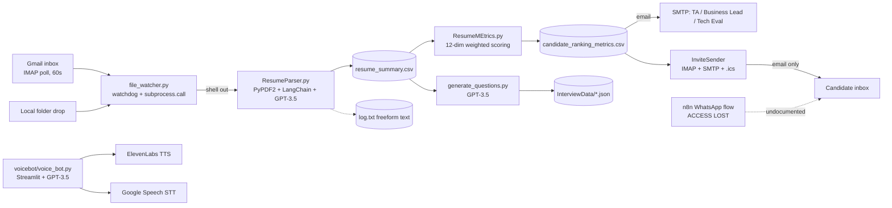
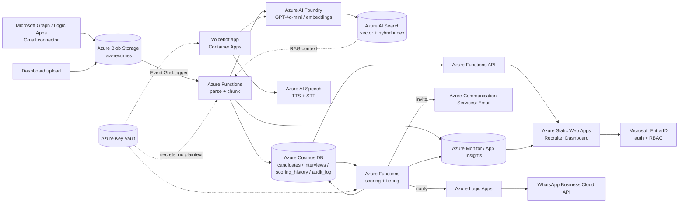

# CDPI Architecture: Current vs. Target

See also the interactive version: `private/CDPI_FDE_Tracker.xlsx` (Azure_Service_Mapping sheet) for cost tiers and Azure-for-Students availability per component. This file is gitignored (local-only) — ask whoever has it for a copy if you don't.

## Current (Brownfield)

Seven standalone Python scripts chained by subprocess calls and folder polling. No shared data store, no frontend, zero automated tests. The n8n WhatsApp flow (dashed, below) is lost — access was lost and it isn't recoverable from this repo.

## Target (Azure-Native)

Event-driven pipeline, one data layer (the context lake), semantic resume-to-JD matching, and a frontend dashboard replacing five scattered file trees and a subprocess chain. Green-stroked nodes in the rendered diagram are net-new capability with no brownfield equivalent today.

Related design docs: [`../prompts/README.md`](../prompts/README.md) (prompt library), [`../semantic-library/README.md`](../semantic-library/README.md) (vector search), [`../context-lake/README.md`](../context-lake/README.md) (Cosmos DB / Blob data layer).
